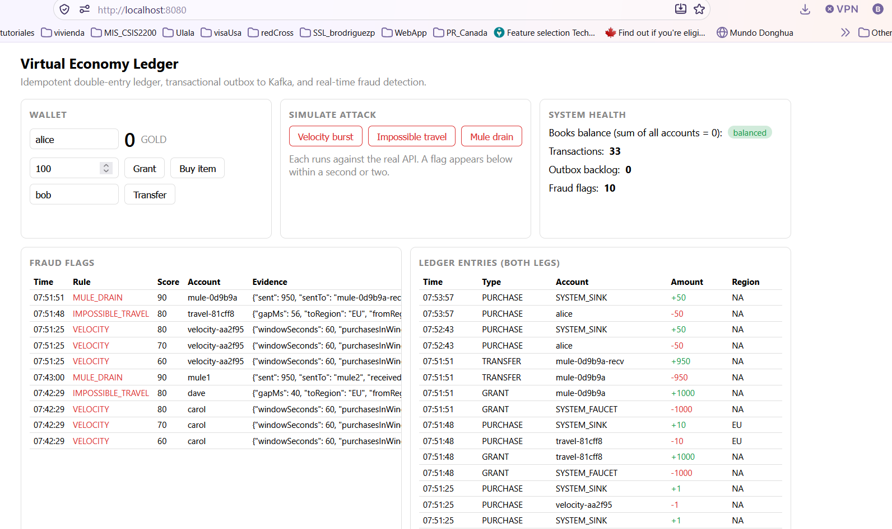
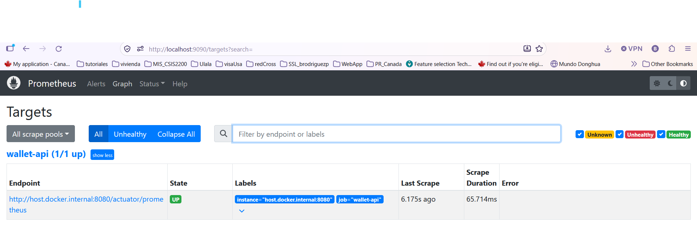
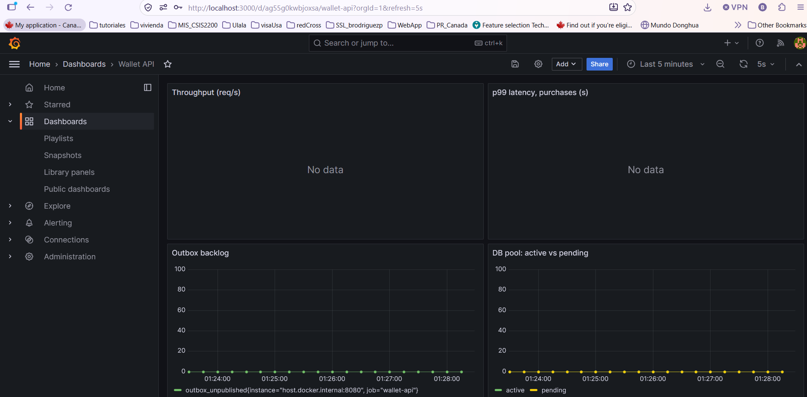

# Virtual Economy Ledger

A cross-game virtual currency backend: an **idempotent double-entry ledger**, a **transactional outbox to Kafka**, and **real-time fraud detection**. Built to explore the problems a large-scale game marketplace has to solve: money correctness under concurrency, reliable events, and abuse detection.

**Live demo:** https://bryan-ledger.duckdns.org (click *Simulate attack* and watch flags appear)
**Walkthrough (90s):** TBA

**Stack:** Java 21 (virtual threads), Spring Boot 4, Postgres 16, Kafka API (Redpanda), Flyway, Testcontainers, Micrometer + Prometheus + Grafana, k6, Docker Compose, Caddy (auto-HTTPS).

---

## Architecture

```
Browser / API client
        │  REST (Idempotency-Key header)
        ▼
   wallet-api ──── one DB transaction ───►  Postgres
   (Spring Boot)    ├─ claim idempotency key     ├─ accounts (balances)
                    ├─ lock accounts (sorted)    ├─ ledger_entries (append-only)
                    ├─ write 2 ledger entries    └─ outbox
                    └─ write outbox event
                                                      │ poll (FOR UPDATE SKIP LOCKED)
                                                      ▼
                                       Kafka topic: economy.transactions
                                                      │
                                              fraud consumer ──► fraud_flags ──► dashboard
```

## Design decisions

| Problem | Solution |
|---|---|
| Double-charge on client retries | `Idempotency-Key` header, unique index + `ON CONFLICT DO NOTHING`. A replay returns the original result (HTTP 200). Same key with a different body returns 409. |
| Double-spend under concurrency | Row locks (`SELECT … FOR UPDATE`) with a balance check inside the same transaction. |
| Deadlocks on A→B / B→A transfers | Accounts are always locked in sorted ID order. |
| Money created or lost | Double-entry: every transaction writes legs that sum to zero. A **deferred constraint trigger** rejects unbalanced transactions at commit, and a trigger makes the ledger **append-only**. |
| DB and Kafka disagreeing (dual write) | **Transactional outbox**: the event is written in the same commit as the money movement, then relayed to Kafka (at-least-once). Purchases keep working if Kafka is down. |
| Duplicate events | Consumers dedupe on `eventId`, and flags have a unique `(event_id, rule)` index. |
| Hot system accounts | Sink and faucet accounts are sharded 16 ways. Correctness is the global sum, not any single balance. |

## Fraud rules

| Rule | Trigger |
|---|---|
| `VELOCITY` | More than 5 purchases by a player in 60 s |
| `IMPOSSIBLE_TRAVEL` | Same player in two regions within 10 s |
| `MULE_DRAIN` | Player receives ≥ 500, then sends ≥ 90% of it out within 5 min |

Rules are pure logic with unit tests (`FraudRulesTest`).

## Tests

- **Concurrency tests against real Postgres (Testcontainers):** 50 threads fight over a wallet that can afford 10 purchases (exactly 10 succeed); 20 threads send the *same* idempotency key (charged once); 100 opposite-direction transfers (no deadlock). Each test asserts that all balances still sum to zero.
- I verified the double-spend test **fails** with the row lock removed, so it is a real regression guard.

## Load test results

k6, mixed workload (80% purchases, 15% grants, 5% transfers), fraud detector disabled. Hardware: **TODO (CPU, cores, RAM; Docker Desktop on Windows)**.

| Scenario | Config | Throughput | Notes |
|---|---|---|---|
| Ramp to 500 req/s, 500 players | Single sink/faucet, pool 10 | ~65 req/s | Saturated; ~80% of offered load dropped. Latency under overload is queueing, not service time. |
| Same, 1 player (hot wallet) | Single sink/faucet, pool 10 | ~36–44 req/s | 10–16% timeouts |
| Ramp to 500 req/s, 500 players | 16 sharded sink/faucet | TODO | TODO |
| Fixed-rate steps (50 / 100 / 200 req/s) | 16 sharded sink/faucet | TODO | TODO (p95 / p99 per level) |

**What I found:** under overload the service plateaus at ~65 transactions/s. Every purchase updates one shared sink row and every grant one shared faucet row, so they serialize on a single row lock. **Fix:** shard system accounts 16 ways. **After the fix:** TODO (what moved, and what the next bottleneck was: connection pool, commit fsync, or the single DB container). The books stayed balanced after every run (`/v1/admin/invariants`).

## Run it locally

```bash
docker compose up -d      # Postgres, Redpanda, Prometheus, Grafana
./gradlew bootRun         # http://localhost:8080
./gradlew test            # needs Docker (Testcontainers)
k6 run load/mixed.js
```

Production deploy: `docker-compose.prod.yml` (app + Postgres + Redpanda behind Caddy with automatic HTTPS) on a free-tier ARM VM.

## API

| Endpoint | Purpose |
|---|---|
| `POST /v1/grants` | Mint currency (requires `Idempotency-Key`) |
| `POST /v1/purchases` | Spend currency on an item (requires `Idempotency-Key`) |
| `POST /v1/transfers` | Player-to-player transfer (requires `Idempotency-Key`) |
| `GET /v1/players/{id}/balance` | Balance |
| `GET /v1/fraud/flags` | Recent fraud flags |
| `GET /v1/admin/invariants` | Ledger sum check, outbox backlog |

## Screenshots





## Known limitations and what I'd change at scale

This is a demo, not production. Being explicit about the gaps:

- **No auth or rate limiting**, and the `/v1/demo/**` attack endpoints are open on purpose. A real service would sit behind authn/z and disable them.
- **Single currency, single Postgres.** At scale: partition ledgers by account, batch updates for hot accounts, read replicas, and a dedicated DB host.
- **Outbox is a poller.** With multiple relays `SKIP LOCKED` can reorder batches. At scale I'd use CDC (Debezium) or a partitioned outbox.
- **Fraud state is in memory**, so a restart loses open windows, and the mule rule's recipient state may live on another partition. Production fix: Kafka Streams with changelog-backed state stores, repartitioned by recipient.
- **Flags go to the DB only.** Publishing them back to Kafka from the consumer would reintroduce dual writes, so that would need an outbox too.
- **Pessimistic locking** was chosen for simplicity under real contention. Hot wallets would need batching or sub-balances.
